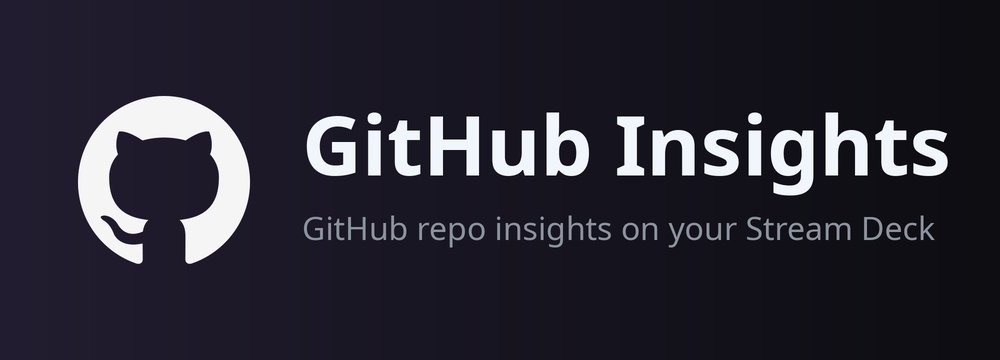
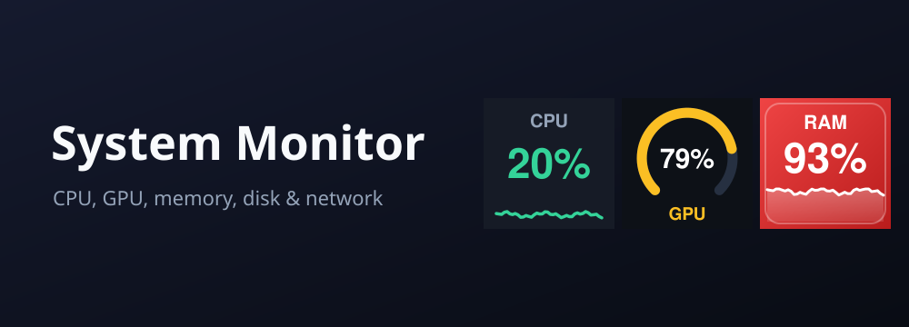
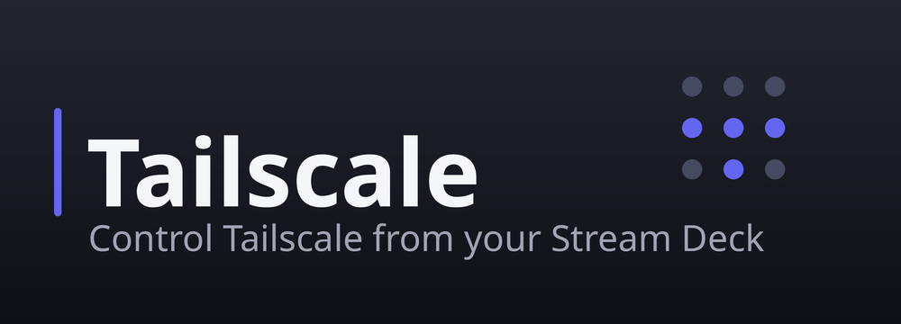

# Stream Deck plugins

Stream Deck plugins built on the official
[Stream Deck SDK](https://docs.elgato.com/streamdeck/sdk/introduction/getting-started)
(`@elgato/streamdeck`). Each one lives in its own folder with its own README,
tests and CI job.

| Plugin | What it does |
| --- | --- |
| [**GitHub Insights**](github/) | Live PR, issue and notification counts, and CI status for a repo, powered by the local `gh` CLI. |
| [**System Monitor**](system-monitor/) | CPU, GPU, memory, disk and network gauges in five styles, turning amber and red past your thresholds. |
| [**Tailscale**](tailscale/) | Connect and disconnect, switch accounts or tailnets, and toggle exit nodes. |

[](github/)
[](system-monitor/)
[](tailscale/)

## Installation

Each CI run uploads an installable `.streamDeckPlugin` per plugin (see the
**Actions** tab). Download one and double-click it; the Stream Deck app
installs it. You can also build one yourself with `just pack <plugin>`.

The plugins target Stream Deck 7.1+ on macOS 12+ and Windows 10+, and also run
under [streamdeck-linux](#local-development-with-streamdeck-linux) on Linux.
See each plugin's README for its own requirements (for example, `gh` or
Tailscale installed).

## Development

Every plugin is a standalone TypeScript project bundled with Rollup and tested
with Vitest:

```
<plugin>/
  src/                                  plugin source (entry point: src/plugin.ts)
  test/                                 unit tests
  scripts/generate-images.ts            regenerates the static artwork (npm run images)
  com.benwyrosdick.<plugin>.sdPlugin/   manifest, property inspectors, images, built bin/
  store/Thumbnail.png                   marketplace / README image
```

You need Node.js 24 and [`just`](https://github.com/casey/just). From the repo
root, recipes take a plugin folder name (`github`, `system-monitor`,
`tailscale`) or default to all of them:

```sh
just install             # npm ci
just build               # bundle into <plugin>/<uuid>.sdPlugin/bin
just check               # type-check, test, build and validate
just pack system-monitor # installable .streamDeckPlugin in system-monitor/dist
```

Or run the npm scripts inside a plugin folder: `npm run build`, `npm test`,
`npm run typecheck`, `npm run validate`, `npm run pack`, `npm run images`.

### Local development with streamdeck-linux

The `Justfile` runs plugins straight from this repo against a local
[streamdeck-linux](https://github.com/benwyrosdick/streamdeck-linux) install:

```sh
just link system-monitor   # build, replace the installed copy with a symlink to this repo, restart
just watch system-monitor  # rebuild and restart on every change
just status                # linked / installed / running, per plugin
just log system-monitor    # the plugin's recent log
just restart tailscale     # restart after a manual build
just unlink tailscale      # remove the link
```

`just link` deletes an installed (copied) version of the plugin before
linking. Keys keep their settings because the plugin IDs don't change.
Changes to a plugin's manifest are picked up by `just link`. The editor window
keeps action-list icons it has already loaded, so reopen it after changing
artwork.

### macOS and Windows

On a machine with the Elgato Stream Deck app, use the Elgato CLI from inside a
plugin folder:

```sh
npx streamdeck link com.benwyrosdick.<plugin>.sdPlugin
npm run watch   # rebuilds and restarts the plugin on every change
```

## CI

Each plugin has a workflow in `.github/workflows/` that only runs when that
plugin's folder (or its workflow) changes. It type-checks, tests, builds,
validates and packages the plugin, then uploads the `.streamDeckPlugin` as an
artifact.

## License

Each plugin is MIT licensed; see the `LICENSE` file in its folder.
