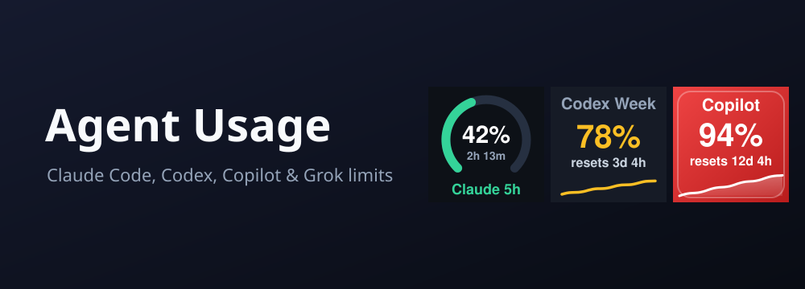

# Agent Usage plugin for Stream Deck



Keep an eye on your coding agents' plan limits from your Stream Deck: Claude
Code's 5-hour and weekly limits, Codex's 5-hour and weekly limits, GitHub
Copilot's monthly premium requests, and Grok's weekly credits, each with a
countdown to its reset and
keys that turn amber and then red as you approach a limit. Built on the
official
[Stream Deck SDK](https://docs.elgato.com/streamdeck/sdk/introduction/getting-started)
(`@elgato/streamdeck`).

The plugin uses each agent's existing login. There are no API keys to paste,
and it never changes an agent's credentials.

## Installation

Download `com.benwyrosdick.agent-usage.streamDeckPlugin` from the latest CI
run or release and double-click it; the Stream Deck app installs it.

## Actions

| Action | Windows | Press |
| --- | --- | --- |
| **Claude Code** | 5-hour session, weekly (all models), weekly Opus, weekly Sonnet: whichever your plan has | Next window |
| **Codex** | 5-hour session, weekly | Next window |
| **GitHub Copilot** | Premium requests (monthly), chat (monthly; usually unlimited) | Next quota |
| **Grok** | Included credits for the current period (weekly on SuperGrok) | Refresh |
| **Overview** | Each chosen agent's most-used window, one row per agent | Refresh |

Every action works on keys and on Stream Deck + dials (press or tap the touch
strip). Pressing an agent key steps through the windows your account has and
saves the choice, so the key keeps showing it.

### Settings

| Setting | Notes |
| --- | --- |
| **Window** | Which limit to show; *First available* (default) is the 5-hour session for Claude and Codex, and premium requests for Copilot. |
| **Show** | Percent used (default) or percent left. |
| **Style** | Classic, Neon, Ring (default), Bars or Solid — the same styles as the System Monitor plugin. |
| **Content** | Usage and reset countdown (default), or usage only. |
| **Label** | Replaces the agent name in the header (up to 10 characters). |
| **Warning colors** | Amber at or above **Warning at** (default 70%), red at or above **Critical at** (default 90%). Always judged on percent used, even when showing percent left. |
| **Agents** | Overview only: which agents get a row. |

### What the key says when there's no reading

| Key | Meaning | Fix |
| --- | --- | --- |
| `Sign in` | No login found for the agent. | Sign in to the agent (`claude auth login`, `codex login`, `gh auth login`, `grok login`). |
| `Expired` | The login's access token has expired. | Run the agent; it renews its login as it runs. For Claude, see below. |
| `N/A` | Signed in a way that has no plan usage (an API key), or the chosen window isn't on your plan. | Sign in with your subscription, or choose another window. |
| `…` + `rate limited` | The usage endpoint asked the plugin to back off; it retries after 10 minutes. | — |
| `Error` + `offline?` | The usage endpoint couldn't be reached and there's no earlier reading. | — |

Once a key has a reading, it keeps showing it through network hiccups.

## How it works

| Agent | Usage source | Login read from |
| --- | --- | --- |
| Claude Code | `GET api.anthropic.com/api/oauth/usage` | macOS Keychain item `Claude Code-credentials`, else `~/.claude/.credentials.json` (or `$CLAUDE_CONFIG_DIR`) |
| Codex | `GET chatgpt.com/backend-api/wham/usage`, the endpoint Codex itself uses | `~/.codex/auth.json` (or `$CODEX_HOME`) |
| GitHub Copilot | `GET api.github.com/copilot_internal/user` | `GH_TOKEN` / `GITHUB_TOKEN`, else `gh auth token` |
| Grok | `GET cli-chat-proxy.grok.com/v1/billing?format=credits`, the endpoint the Grok CLI uses (plus `/v1/settings` for the plan name) | `~/.grok/auth.json` (or `$GROK_HOME`) |

An agent is only polled while a key showing it is visible: every 2 minutes
for Claude, Codex and Grok, and every 5 for Copilot (its quotas are monthly).
Pressing a key refreshes it straight away. Keys re-render every 15 seconds so
reset countdowns stay current.

These are the endpoints the agents and their editor integrations use; they
aren't public, documented APIs, so a vendor change can break a key until the
plugin is updated.

### Claude Code logins

Claude Code renews its access token while it runs. If it hasn't run for a few
hours, the stored token has expired and the Claude key shows `Expired` until
you next use Claude Code.

The Claude key's settings have an opt-in **Refresh the login when it
expires**. With it on, the plugin renews an expired login itself and keeps
the renewed copy in Stream Deck's plugin settings. Claude Code's own
credentials are never written. Anthropic may retire Claude Code's copy of
the login when the plugin renews it, in which case Claude Code asks you to
sign in again. Turning the option off deletes the plugin's copy.

You need that option if Claude Code runs on a `claude setup-token` token
(`CLAUDE_CODE_OAUTH_TOKEN`). Those tokens can't read plan usage, so the
plugin uses the regular `claude auth login` login, which only stays current
if something renews it.

On macOS, the first read of the Keychain item may ask you to allow access.

### Grok

Grok's credits are a single pool for the current billing period, weekly on
SuperGrok plans; the key's header shows the period (`Grok Week`). At the start
of a period the billing API can leave the percentage out instead of sending
zero; while the period is in progress the key reads that as 0%, as Grok's own
web client does. `grok login` tokens last about a week and the Grok CLI renews
them as it runs, so a key shows `Expired` only after a week or so without
using Grok.

## Requirements

- Stream Deck **7.1** or newer, on macOS 12+ or Windows 10+.
- The agents you want to track, signed in with a subscription: Claude Code
  (Pro/Max/Team), Codex (ChatGPT plan), the GitHub CLI signed in to an
  account with Copilot, and/or the Grok CLI signed in to SuperGrok.

## Development

```sh
npm install
npm run build      # bundle src/ into com.benwyrosdick.agent-usage.sdPlugin/bin
npm test           # unit tests (vitest)
npm run validate   # validate the manifest and plugin folder
```

From the repo root, `just link agent-usage` runs it against a local
streamdeck-linux install; see the [root README](../README.md).

The static images in `com.benwyrosdick.agent-usage.sdPlugin/imgs` and the
store thumbnail are generated with the same renderer the plugin uses at
runtime; regenerate them with `npm run images` (needs `rsvg-convert`).

### Layout

```
src/
  plugin.ts              entry point: providers, store, Claude refresh opt-in
  actions/               one SingletonAction per agent, plus Overview and a shared base
  providers/             one module per agent: login lookup, request, response parsing
  store.ts               shared, demand-driven polling with history and backoff
  views.ts               readings + settings → what a key shows (thresholds, countdowns, hints)
  render.ts              SVG key artwork for every style
com.benwyrosdick.agent-usage.sdPlugin/
  manifest.json, en.json plugin manifest and localization
  ui/                    property inspectors (sdpi-components)
  imgs/                  icons
```

## Disclaimer

This is an unofficial plugin, not affiliated with or endorsed by Anthropic,
OpenAI, GitHub or xAI. Claude, Codex, Copilot and Grok are trademarks of their owners and
are used here only to say what the plugin works with.

## License

[MIT](LICENSE) © Ben Wyrosdick
