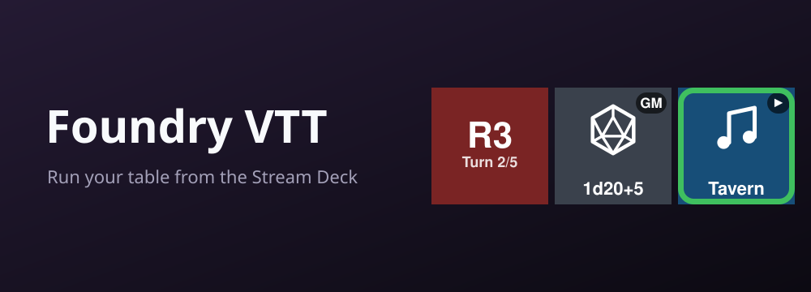

# Foundry VTT plugin for Stream Deck



Run your [Foundry Virtual Tabletop](https://foundryvtt.com) table (v13/v14)
from a Stream Deck: macros, scenes, the selected token, the combat tracker,
music and sounds, pause, dice, roll tables, chat, scene darkness and sidebar
tabs. Keys show live state from the game — scene thumbnails, which scene is
active, the playing track, the round and turn, the selected token and its
hit points.

It comes in two parts that work together:

| Part | Install it | What it does |
| --- | --- | --- |
| Stream Deck plugin **Foundry VTT** (`com.benwyrosdick.foundry-vtt`) | on the computer the Stream Deck is plugged into | draws the keys and passes presses on |
| Foundry module **Stream Deck Bridge** (`stream-deck-bridge`, in [`module/`](module/)) | in Foundry | does the work in the game and says what each key should show |

Built on the official
[Stream Deck SDK](https://docs.elgato.com/streamdeck/sdk/introduction/getting-started)
(`@elgato/streamdeck`), and modeled on [VTT Deck](https://github.com/zedoc84/vtt-deck)
(MIT): the same split between plugin and module, the same pairing scheme, and
its free feature set.

## Installation

1. **Stream Deck plugin**: download `com.benwyrosdick.foundry-vtt.streamDeckPlugin`
   from the latest CI run or [release](https://github.com/benwyrosdick/streamdeck-plugins/releases)
   and double-click it.
2. **Foundry module**: in Foundry, *Add-on Modules → Install Module*, and paste
   this manifest URL:

   ```
   https://raw.githubusercontent.com/benwyrosdick/streamdeck-plugins/main/foundry-vtt/module/module.json
   ```

   Or unzip `stream-deck-bridge.zip` (from a release or CI run) into Foundry's
   `Data/modules/stream-deck-bridge/` folder. Then enable **Stream Deck Bridge**
   in your world.
3. **Pair them**, once per browser: drag any Foundry VTT action onto a key, and
   in its settings under the connection panel, **Copy** the pairing code. In
   Foundry: *Configure Settings → Stream Deck Bridge → Pairing code*, paste,
   save. Foundry says *Stream Deck connected*, and the key's settings show
   *Connected to <world> as <you> (GM)*.

The plugin talks to the **browser** that has Foundry open, not to the Foundry
server, so open the game in a browser (or the Foundry app) on the computer the
Stream Deck is plugged into. That works wherever Foundry is hosted: your own
computer, a server on your network, or a hosting service.

## Actions

| Action | Shows | Press |
| --- | --- | --- |
| **Macro** | The macro's image and name | Runs the macro |
| **Scene** | The scene's thumbnail and name; green border = active for everyone, blue = the one you're viewing | View it, activate it for everyone (GM), or open its configuration |
| **Token** | The token selected on the canvas: picture, name, and optionally bar 1 (usually hit points) as a gauge | Centre the view on it, or open/close its sheet |
| **Combat** | Next/previous turn and round, start, end, roll initiative (all or NPCs), or the current round and turn | Drives the combat tracker; *Start* creates an encounter from the selected tokens if there isn't one |
| **Music & Sounds** | A playlist or a single sound (green border while it plays), or *Stop all* | Starts or stops it |
| **System** | Pause (red border while paused), a dice roll, a roll table, a chat message, a darkness level, or a sidebar tab | Pause/resume (GM), roll (current mode, public, GM only or just you), draw from the table, post the message (optionally whispered to the GM), set the scene's darkness (GM), open the tab |

The inspector's lists — macros, scenes, playlists and their sounds, roll
tables — come straight from your world, grouped by folder, so Foundry must be
open and paired to fill them (the ↻ button reloads a list).

Every action works on keys and on Stream Deck + dials (press or tap the touch
strip). A greyed key has nothing to do right now (no combat to advance,
nothing playing). Keys read **Offline** while no paired Foundry window is
connected. If a press fails — a deleted macro, a GM-only action as a player —
the key shows the Stream Deck alert and Foundry says why.

## Foundry module settings

All per browser (*Configure Settings → Stream Deck Bridge*):

| Setting | Default | Notes |
| --- | --- | --- |
| Connect to the Stream Deck from this browser | Auto (GM only) | *Always* / *Never*. Auto keeps players' browsers from asking for local network access. |
| Pairing code | — | From any Foundry VTT key's settings. |
| Plugin port | 3010 | Must match the plugin's port (in any key's settings). |
| Plugin address | 127.0.0.1 | Keep it unless the Stream Deck is on another computer. |
| Connection notifications | on | Says when the Stream Deck connects. |

Only one Foundry window controls the Stream Deck at a time: the last one to
connect. The earlier one steps aside.

## Security

The plugin listens on `127.0.0.1` only, so nothing outside the computer can
reach it. Any web page open in your browser could, though, which is what
pairing is for:

- A connection must answer a random challenge with an HMAC keyed by the
  pairing code within 5 seconds, or it's closed. The code itself is never sent.
- The plugin then proves it knows the code too; the module ignores a program on
  the port that can't, so nothing else can drive your game.
- After 5 wrong codes in a row, pairing is refused for 30 seconds, doubling up
  to 10 minutes, so the code can't be guessed. **Make a new code** in any key's
  settings disconnects the current window until it's given the new code.
- Key settings can only point at existing macros, scenes, playlists and tables
  by id; chat messages are posted as plain text, so an imported profile can't
  smuggle in HTML or scripts.

## Troubleshooting

- **Keys say Offline**: is the world open in a browser on this computer, with
  the module enabled and paired? Check the status line in any key's settings.
- **"Rejected a Foundry window with the wrong pairing code"**: copy the code
  again into Foundry's module settings.
- **Chrome or Edge asks to access devices on your local network**: allow it;
  that's the Foundry page reaching the plugin on this computer.
- **Foundry over HTTPS in Safari**: Safari can block the page from reaching
  `ws://127.0.0.1`. Use Chrome, Firefox, or the Foundry desktop app.
- **"Not listening: Port 3010 is in use"**: pick another port in any key's
  settings, and the same one in Foundry's module settings.
- Open <http://127.0.0.1:3010> in a browser: the plugin answers
  *Stream Deck Bridge for Foundry VTT — OK*.

## How it works

```
Stream Deck ── plugin (WebSocket server, 127.0.0.1:3010) ── browser tab with Foundry + module
```

The module tells the plugin what each key should show — a glyph, a picture
(thumbnailed in the browser), a title, big text, a gauge, a state border —
and the plugin draws it, so keys look consistent and the drawing is tested
here. It re-renders after the Foundry hooks that can change a key (debounced,
sending only keys whose view changed) and runs presses through Foundry's API.
The protocol is documented in [`src/bridge/protocol.ts`](src/bridge/protocol.ts).

## Development

```sh
npm install
npm run build      # bundle src/ into com.benwyrosdick.foundry-vtt.sdPlugin/bin
npm test           # unit tests, including the module against a fake Foundry
npm run validate   # validate the manifest and plugin folder
npm run module     # dist/stream-deck-bridge.zip, the Foundry module
```

From the repo root, `just link foundry-vtt` runs the plugin against a local
streamdeck-linux install; see the [root README](../README.md). For the module,
symlink `module/` into Foundry's `Data/modules/stream-deck-bridge` and reload
the world after changes.

The tests run the module's real connection code against the plugin's real
server, so the two halves of the pairing protocol are checked against each
other; Foundry itself is faked.

To release, bump `version` (and the `download` URL) in `module/module.json` and
push a `foundry-vtt-vX.Y.Z` tag: CI publishes the plugin, the module zip and
`module.json` as a GitHub release, which is where the manifest's download URL
points.

### Layout

```
src/
  plugin.ts              entry point: server, pairing code, actions
  bridge/protocol.ts     the messages both halves exchange
  bridge/pairing.ts      pairing codes and HMACs
  bridge/server.ts       the WebSocket server: pairing, lockout, one window at a time
  deck.ts                every Foundry key: sync with Foundry, cached views
  actions/               the six actions (one shared implementation)
  render.ts              SVG key artwork from a view
module/                  the Foundry module (plain ES modules, no build step)
  scripts/main.js        settings, start-up
  scripts/bridge.js      the WebSocket client and its side of pairing
  scripts/actions.js     what each kind of key shows and does in Foundry
  scripts/deck.js        keys, re-rendering on hooks, presses
com.benwyrosdick.foundry-vtt.sdPlugin/
  manifest.json, en.json plugin manifest and localization
  ui/                    property inspectors (sdpi-components) and the shared connection panel
  imgs/                  icons
```

## Disclaimer

An unofficial project, not affiliated with Foundry Gaming LLC or Corsair.
Foundry Virtual Tabletop is a trademark of Foundry Gaming LLC.

## License

[MIT](LICENSE) © Ben Wyrosdick. The pairing scheme and the Foundry API usage
follow [VTT Deck](https://github.com/zedoc84/vtt-deck), MIT.
