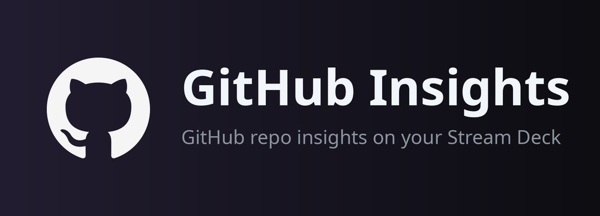

# GitHub Insights plugin for Stream Deck



Surface [GitHub](https://github.com) repo insights on your Stream Deck, powered
by the local [`gh`](https://cli.github.com) CLI. Built on the official
[Stream Deck SDK](https://docs.elgato.com/streamdeck/sdk/introduction/getting-started)
(`@elgato/streamdeck`).

## Installation

Download `com.benwyrosdick.github.streamDeckPlugin` from the latest CI run or
release and double-click it; the Stream Deck app installs it.

## Actions

| Action | What it does |
| --- | --- |
| **PR Count** | Shows a live count of pull requests in a repo matching a filter (author, approval status, labels, state). Press the key to open the equivalent GitHub PR search in your browser. |
| **Issue Count** | Shows a live count of issues in a repo matching a filter (author, assignee, labels, state). Press the key to open the equivalent GitHub issue search in your browser. |
| **CI Status** | Shows the status of the latest GitHub Actions run for a repo — green ✓ (success), red ✗ (failure), spinning amber ↻ (in progress), grey dots (queued / waiting), grey dash (no runs / cancelled). While a run is in progress it also shows live step progress (e.g. `4 / 9`) at the bottom. Press to open the run (or the repo's Actions page) in your browser. |
| **Notification Count** | Shows a live count of your unread GitHub notifications, optionally scoped to a single repo and to a common inbox filter (Assigned, Participating, Mentioned, Team mentioned, Review requested). Press the key to open the matching GitHub notifications view. |

Every action works on keys and on Stream Deck + dials (press or tap the touch
strip). Counts above zero light the key blue. A red outline means the key
needs attention — no repository is set, or `gh` isn't signed in (the key
reads `auth`). Pressing an unconfigured key shows the Stream Deck alert
indicator.

### PR Count filters

Configure each key in its property inspector:

| Setting | Notes |
| --- | --- |
| **Button label** | Short name shown on the key (e.g. "My Open"). |
| **Repository** | `owner/name`, e.g. `benwyrosdick/streamdeck-github`. |
| **Author** | Anyone / Me / Not me / Specific user / Not a user. |
| **User** | The username used when Author is *Specific user* or *Not a user*. |
| **Approval** | Any / Pending review / Approved / Changes requested / Review required. |
| **Labels** | Comma-separated; matches any of them (OR). |
| **State** | Open (default) / Closed / Merged / All. |
| **Advanced query** | Raw GitHub search qualifiers appended verbatim (e.g. `draft:false`). |

**Examples**

- **My Open** — Author: *Me*, Approval: *Pending review*, State: *Open*.
- **For Review** — Author: *Not me*, Labels: `api`, Approval: *Pending review*, State: *Open*.

### Issue Count filters

| Setting | Notes |
| --- | --- |
| **Button label** | Short name shown on the key (e.g. "My Issues"). |
| **Repository** | `owner/name`. |
| **Author** | Anyone / Me / Not me / Specific user / Not a user. |
| **User** | The username used when Author is *Specific user* or *Not a user*. |
| **Assignee** | Anyone / Me / Not me / Unassigned. |
| **Labels** | Comma-separated; matches any of them (OR). |
| **State** | Open (default) / Closed / All. |
| **Advanced query** | Raw GitHub search qualifiers appended verbatim (e.g. `milestone:v2`). |

### CI Status filters

| Setting | Notes |
| --- | --- |
| **Button label** | Short name shown on the key; defaults to the workflow name. |
| **Repository** | `owner/name`. |
| **Workflow** | Optional — a workflow name (`CI`) or file (`ci.yml`). Blank = any workflow. |
| **Branch** | Optional — blank = any branch. |

### Notification Count filters

| Setting | Notes |
| --- | --- |
| **Button label** | Short name shown on the key (e.g. "Inbox"). |
| **Repository** | Optional — `owner/name` to count only that repo's notifications; blank counts across all repos. |
| **Filter** | All unread (default) / Assigned / Participating / Mentioned / Team mentioned / Review requested — mirrors the inbox's Filters. |

## Requirements

- Stream Deck **7.1** or newer, on macOS 12+ or Windows 10+.
- The `gh` CLI installed and authenticated (`gh auth status`). The plugin uses
  your existing `gh` login — **no API key or extra setup required**. It looks
  for `gh` in the usual places:
  - macOS: `/opt/homebrew/bin/gh`, `/usr/local/bin/gh`, `/opt/local/bin/gh`
  - Windows: `%ProgramFiles%\GitHub CLI\gh.exe`,
    `%LOCALAPPDATA%\Programs\GitHub CLI\gh.exe`

  and otherwise falls back to `gh` on `PATH`.

If `gh` isn't authenticated, run `gh auth login` once. Until then, keys show
an `auth` hint instead of a number.

## How it works

The plugin shells out to the local `gh` CLI. Counts come from a single GraphQL
`search { issueCount }` call — it returns just the total without fetching the
matching PRs, the cheapest way to count. Each unique filter's result is cached
(~45s for counts, ~30s for CI runs, ~60s for notifications) and refreshed in
the background, shared across all keys, so keys never wait on the network and
GitHub isn't polled more than necessary no matter how many keys you have.
Pressing a key refreshes its value.

If GitHub rate-limits the plugin, all polling pauses until the limit resets;
keys turn red and count down to the reset.

Key artwork is generated as SVG at runtime, which is how the icon, labels and
background compose into one image, and how the CI spinner animates.

## Development

```sh
npm install
npm run build      # bundle src/ into com.benwyrosdick.github.sdPlugin/bin
npm test           # unit tests (vitest)
npm run validate   # validate the manifest and plugin folder
```

To iterate against a local Stream Deck install, link the plugin once and run
the watcher, which rebuilds and restarts the plugin on every change:

```sh
npx streamdeck link com.benwyrosdick.github.sdPlugin
npm run watch
```

The static images in `com.benwyrosdick.github.sdPlugin/imgs` are generated
from the same shapes the plugin draws at runtime; regenerate them with
`npm run images` (needs `rsvg-convert` for the marketplace PNG).

`npm run pack` produces an installable `dist/com.benwyrosdick.github.streamDeckPlugin`.

### Layout

```
src/
  plugin.ts              entry point: registers actions, starts the tick
  actions/               one SingletonAction per action, plus a shared base
  github/cli.ts          locates and runs the gh CLI
  github/queries.ts      pure search-query / URL builders
  github/store.ts        shared, cached, non-blocking reads + rate-limit state
  render.ts              SVG key artwork
com.benwyrosdick.github.sdPlugin/
  manifest.json, en.json plugin manifest and localization
  ui/                    property inspectors (sdpi-components)
  imgs/                  icons
```

## Notes

- "Not me" / negated-author filters are always scoped to the configured repo,
  so they stay fast and accurate (an unscoped negation would span all of
  GitHub).

## Disclaimer

This is an unofficial, community-maintained plugin. It is not affiliated with,
sponsored by, or endorsed by GitHub, Inc. "GitHub" is a trademark of GitHub,
Inc.; it is used here nominatively only to indicate compatibility.

## License

[MIT](LICENSE) © Ben Wyrosdick
