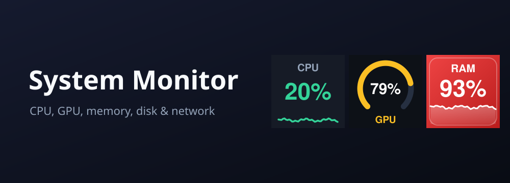

# System Monitor plugin for Stream Deck



Live CPU, GPU, memory, disk and network gauges for your Stream Deck, in five
styles, with keys that turn amber and then red as a metric climbs. Built on
the official
[Stream Deck SDK](https://docs.elgato.com/streamdeck/sdk/introduction/getting-started)
(`@elgato/streamdeck`).

## Installation

Download `com.benwyrosdick.system-monitor.streamDeckPlugin` from the latest CI
run or release and double-click it; the Stream Deck app installs it.

## Actions

| Action | Shows | Combined adds | Press |
| --- | --- | --- | --- |
| **CPU** | Overall CPU utilization | Package temperature (where available), busiest core | Refresh |
| **GPU** | GPU utilization | Temperature, GPU memory used / total | Refresh |
| **Memory** | Memory in use | Used / total | Refresh |
| **Disk** | How full a drive is | Free space | Next drive |
| **Network** | Download or upload rate | The other direction | Switch ↓ / ↑ |
| **Overview** | Up to five metrics stacked on one key, each with its own bar | — | Refresh |

Every action works on keys and on Stream Deck + dials (press or tap the touch
strip).

### Single and combined keys

Each metric key has a **Content** setting:

- **Single metric** — the header and the big reading (e.g. `CPU` / `20%`).
- **Combined** — adds the metric's details: `GPU 64°C` / `39%` /
  `6.1 GB / 16.0 GB`, `RAM` / `61%` / `19.4 GB / 32.0 GB`, `C:` / `58%` /
  `390 GB free`, and so on.

For several different metrics on one key, use **Overview**.

### Styles

| Style | Look |
| --- | --- |
| **Classic** | Muted header, colored reading, thin line graph. |
| **Neon** | Accent bar beside the header, white reading, glowing area graph. |
| **Ring** | A 270° gauge around the reading, label underneath. |
| **Bars** | Header band with a status dot, and a 10-step level meter. |
| **Solid** | The whole key filled with the status color, white reading and graph. |

### Warning colors

With **Warning colors** on (the default), keys are green normally, amber at
or above **Warning at** (default 70%) and red at or above **Critical at**
(default 90%). The colors follow through every style — the reading, graph,
ring, meter, status dot, or the whole key for Solid.

Network rates have no natural 100%, so a Network key only colors once you set
a **Full scale** link speed (in Mbit/s, e.g. `1000`); thresholds then apply to
that percentage. Without one, the graph and meter scale to the recent peak.

### Settings

| Setting | Actions | Notes |
| --- | --- | --- |
| **Style** | metric keys | Classic (default) / Neon / Ring / Bars / Solid. |
| **Content** | metric keys | Single metric (default) / Combined. |
| **Label** | metric keys | Replaces the header text (up to 10 characters). |
| **Warning colors** | all | On by default. |
| **Warning at / Critical at** | all | 50–100% in 5% steps. |
| **Drive** | Disk | System drive (default) or any mounted volume. Pressing the key also cycles drives. |
| **Direction** | Network | Download (default) / Upload. Pressing the key also switches. |
| **Units** | Network | Bytes (MB/s, default) / Bits (Mb/s). |
| **Full scale** | Network | Link speed in Mbit/s that counts as 100%; blank = auto. |
| **Metrics** | Overview | Any of CPU, GPU, Memory, Disk (system drive), Network (download). |

## Requirements

- Stream Deck **7.1** or newer, on macOS 12+ or Windows 10+.
- Nothing else — every reading comes from tools that ship with the OS (plus
  `nvidia-smi`, which installs with NVIDIA's driver).

## How it works

A single shared monitor samples the system once a second, and only the
metrics a visible key has asked for in the last few seconds: a deck showing
just a CPU key never touches the GPU. Disks are re-read every 10 seconds.
Each metric keeps 40 readings of history for the graphs, and keys only push a
new image when what they show changes.

| Metric | macOS | Windows | Linux (development) |
| --- | --- | --- | --- |
| CPU | `os.cpus()` time deltas | same | same, plus hwmon package temperature |
| Memory | `vm_stat` (matches Activity Monitor's "Memory Used") | `os.freemem()` | `os.freemem()` (MemAvailable) |
| Disk | `statfs` on `/` and `/Volumes/*` | `statfs` on drive letters | `statfs` on `/proc/mounts` block devices |
| Network | `netstat -ibn`, physical `enN` interfaces | `netstat -e` | `/sys/class/net`, physical interfaces |
| GPU | `nvidia-smi`, else `ioreg` IOAccelerator stats | `nvidia-smi`, else GPU performance counters | `nvidia-smi`, else amdgpu sysfs |

Notes:

- **GPU temperature** comes from `nvidia-smi` or amdgpu. Apple silicon and the
  Windows performance counters don't expose it, so combined GPU keys there
  show utilization and memory only.
- **CPU temperature** isn't readable on macOS or Windows without elevated
  helper tools, so combined CPU keys there show the busiest core instead.
- On Windows without an NVIDIA card, a single long-lived PowerShell process
  reads the GPU performance counters (the figure Task Manager shows) every two
  seconds — far cheaper than starting PowerShell per sample. It only runs while
  a GPU key is visible, and exits with the plugin. The counter names are
  English, so this fallback needs an English-language Windows.
- Network rates exclude loopback, VPN tunnels and virtual adapters so traffic
  isn't counted twice.

## Development

```sh
npm install
npm run build      # bundle src/ into com.benwyrosdick.system-monitor.sdPlugin/bin
npm test           # unit tests (vitest)
npm run validate   # validate the manifest and plugin folder
```

To iterate against a local Stream Deck install, link the plugin once and run
the watcher, which rebuilds and restarts the plugin on every change:

```sh
npx streamdeck link com.benwyrosdick.system-monitor.sdPlugin
npm run watch
```

The static images in `com.benwyrosdick.system-monitor.sdPlugin/imgs` and the
store thumbnail are generated with the same renderer the plugin uses at
runtime; regenerate them with `npm run images` (needs `rsvg-convert`).

`npm run pack` produces an installable `dist/com.benwyrosdick.system-monitor.streamDeckPlugin`.

### Layout

```
src/
  plugin.ts              entry point: registers actions, starts the tick
  actions/               one SingletonAction per action, plus a shared base
  metrics/               per-platform collectors and their output parsers
  monitor.ts             shared, demand-driven sampler with history
  views.ts               readings + settings → what a key shows (thresholds, formatting)
  render.ts              SVG key artwork for every style
com.benwyrosdick.system-monitor.sdPlugin/
  manifest.json, en.json plugin manifest and localization
  ui/                    property inspectors (sdpi-components)
  imgs/                  icons
```

## License

[MIT](LICENSE) © Ben Wyrosdick
