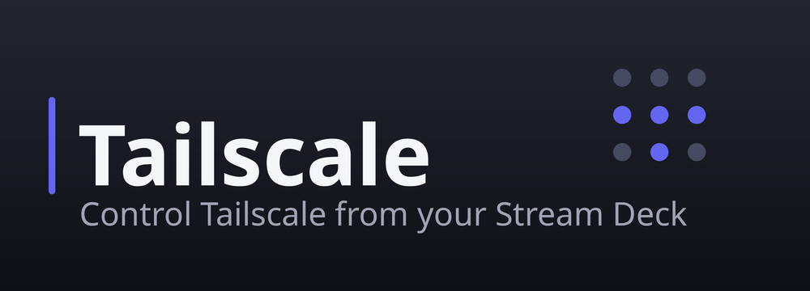

# Tailscale plugin for Stream Deck



Control [Tailscale](https://tailscale.com) from your Stream Deck. Built on the
official [Stream Deck SDK](https://docs.elgato.com/streamdeck/sdk/introduction/getting-started)
(`@elgato/streamdeck`).

## Installation

Download `com.benwyrosdick.tailscale.streamDeckPlugin` from the latest CI run
or release and double-click it; the Stream Deck app installs it.

## Actions

| Action | What it does |
| --- | --- |
| **Connect** | `tailscale up` |
| **Disconnect** | `tailscale down` |
| **Toggle Connection** | Toggles up/down and shows live status — green when connected, black when down, amber while connecting. Optionally tied to one account (see below). |
| **Switch Account** | Toggles between two configured profiles (`tailscale switch`). Pick *Account A* and *Account B* (and optionally a color for each) in the property inspector. |
| **Toggle Exit Node** | Toggles a configured exit node on/off (`tailscale set --exit-node=…`). The node is remembered per account and falls back to automatic selection when unavailable. |

### Toggle Connection per tailnet

Toggle Connection has an optional **Account** setting:

- **Last used account** (default) — toggles whichever account Tailscale is on.
- **A specific account** — the key belongs to that account's tailnet. It's lit
  only while that tailnet is connected; pressing it while that tailnet is
  connected disconnects, and pressing it otherwise switches to that account
  (`tailscale switch`) and connects. The key is labelled with its tailnet.

Give each tailnet its own key and switching between them is a single press.
After a switch, the plugin only runs `tailscale up` if the account was left
disconnected; an account that was running when you last left it reconnects on
its own.

Every action works on keys and on Stream Deck + dials (press or tap the touch
strip). A red badge means Tailscale couldn't be reached; a failed command shows
the Stream Deck alert indicator.

## Requirements

- Stream Deck **7.1** or newer, on macOS 12+ or Windows 10+.
- Tailscale installed. The plugin looks for the CLI in the usual places:
  - macOS: `/Applications/Tailscale.app/Contents/MacOS/Tailscale`,
    `/opt/homebrew/bin/tailscale`, `/usr/local/bin/tailscale`
  - Windows: `%ProgramFiles%\Tailscale\tailscale.exe`

  and otherwise falls back to `tailscale` on `PATH`.

## How it works

The plugin shells out to the local `tailscale` CLI. It does **not** use the
Tailscale cloud API (no API key needed). Status is read from
`tailscale status --json` and cached for ~2 seconds, shared across all keys, so
the daemon is polled at most about once every couple of seconds no matter how
many Tailscale keys you have. After any command, status is re-read immediately
so every key updates together.

Key artwork is generated as SVG at runtime, which is how keys get recolored per
state and per account.

## Development

```sh
npm install
npm run build      # bundle src/ into com.benwyrosdick.tailscale.sdPlugin/bin
npm test           # unit tests (vitest)
npm run validate   # validate the manifest and plugin folder
```

To iterate against a local Stream Deck install, link the plugin once and run
the watcher, which rebuilds and restarts the plugin on every change:

```sh
npx streamdeck link com.benwyrosdick.tailscale.sdPlugin
npm run watch
```

The static images in `com.benwyrosdick.tailscale.sdPlugin/imgs` are generated
from the same shapes the plugin draws at runtime; regenerate them with
`npm run images` (needs `rsvg-convert` for the marketplace PNG).

`npm run pack` produces an installable `dist/com.benwyrosdick.tailscale.streamDeckPlugin`.

### Layout

```
src/
  plugin.ts                 entry point: registers actions, starts polling
  actions/                  one SingletonAction per action, plus a shared base
  tailscale/cli.ts          locates and runs the tailscale CLI
  tailscale/status.ts       pure interpreters for `tailscale status --json`
  tailscale/status-store.ts shared, cached status + polling
  render.ts                 SVG key artwork
com.benwyrosdick.tailscale.sdPlugin/
  manifest.json, en.json    plugin manifest and localization
  ui/                       property inspectors (sdpi-components)
  imgs/                     icons
```

## Notes

- Switching to a profile whose login has expired may open a browser for
  re-authentication; log in to each profile at least once first.
- Exit-node candidates are discovered from your tailnet automatically (any
  peer advertising itself as an exit node).

## Disclaimer

This is an unofficial, community-maintained plugin. It is not affiliated with,
sponsored by, or endorsed by Tailscale Inc. "Tailscale" is a trademark of
Tailscale Inc.; it is used here nominatively only to indicate compatibility.

## License

[MIT](LICENSE) © Ben Wyrosdick
